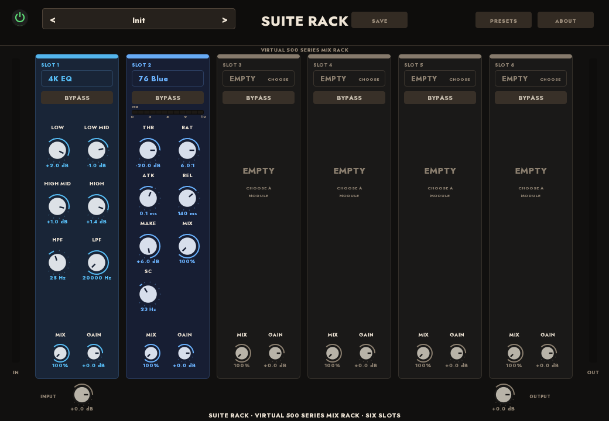

# Suite Rack

**Status: M0 scaffold with a working CLAP build.** LV2 wrapper, rack state
recall, host automation and the full module catalog are next.

A virtual 500-series rack in the Suite visual language: six serial slots, each
hosting one compact module. Slot 1 starts as EQ, slot 2 as Comp, slots 3–6 are
empty. Modules are chosen from an in-panel browser.

Suite Rack is the flagship “try all my stuff” plugin: one insert that gives the
flavour of the whole Suite, plus new mix-world extras. Each module is limited to
a real 500-series control set — one job, a handful of knobs, no deep pages. The
standalone plugins remain the full versions.

> Better plugins exist. I just wanted to have a Suite Rack.





## What goes in the rack

**From the Suite:**

- **Comp Suite** — Clean, Easy, 76Blue, 76Black, 2A, 3A, Xpress, VCA, Molot, Red
- **Patina** — Valve, Console, Bus, Tape, Transformer
- **Space Suite** — Plate, Room, Hall, Spring, Digital/Tape/Analog/Ping-Pong
  Delay, Chorus, Flanger, Phaser, Dimension
- **Vocal Suite** — De-Ess, Air
- **Drum Suite** — Transient, Clip, Bleed Out gate
- **Trowel** — Smoothing, Tame
- **Suite Channel** — 4K EQ, Gate/Ducker
- **Hearth** — Hearth EQ, Hearth Comp
- **Adhesive** — Glue, Reel
- **Brick / Mastering Suite** — Peak Limiter, Tilt, Density
- **Ember** — Ember finish
- **Repair Suite** — Cleanup (De-Click + De-Hum only)
- **JClones** — 16 neutral-named ports, including L2, Classic Limiter, Hyrax,
  O3, Modern Limiter, RS-124, VBL, CL-1B, LMC-1, Bloom, Fattener, AC-1,
  Tape Head, DuTape, Tube Driver and DaTube

**New extras:**

- **Image** — stereo width, mono-maker, balance, M/S
- **Dynamic EQ** — frequency-selective dynamics
- **Multiband** — 3-band compressor
- **Sub** — subharmonic synthesizer
- **Double** — doubler / microshift
- **Filter** — auto-filter / envelope filter
- **Crush** — bitcrusher / lo-fi
- **Motion** — tremolo / auto-pan / rotary
- **Rider** — auto-level / vocal rider

**Not in the rack:** Common Sense EQ, Amp Suite, Bass Suite, and the deep Repair
Suite tools (spectral editor, De-Clip, De-Reverb, De-Noise). Those do not fit
the 500-series format; Cleanup is the lightweight repair representative.

## Current M0 slice

- 1040×720 panel with the Comp Suite-family header: power, preset bar, centered
  title, utility pills.
- Six vertical 500-series-style module columns, each with its own background and
  knob colour.
- Per-slot bypass and slot mix.
- Module browser: **Off / EQ / Comp**.
- EQ module: four bands + HPF/LPF.
- Comp module: 76 / 2A / VCA with threshold, ratio, attack, release, makeup,
  mix and sidechain HPF.
- Serial engine and per-slot meters in place; DSP and panel tests pass.
- **CLAP build loads in REAPER**, opens the six-column editor and processes
  audio.
- LV2 wrapper, rack state recall and the remaining modules are next.

## Architecture

```
Input → Slot 1 → Slot 2 → Slot 3 → Slot 4 → Slot 5 → Slot 6 → Output
```

Each slot owns a module instance and a 16-control parameter block. Module type
and module state are stored separately, so the host parameter count stays small
even with the full catalog. Automation follows the slot, not the module: if a
slot changes module, its control lanes are repurposed.

## Build and preview

```sh
cmake -S . -B build -DCMAKE_BUILD_TYPE=Release
cmake --build build -j
ctest --test-dir build --output-on-failure
./build/rack_ui_preview assets/fonts /tmp/suite-rack-preview
```

## Install CLAP

```sh
cp build/clap/SuiteRack.clap ~/.clap/
cp -r build/clap/SuiteRack.resources ~/.clap/
```

## Next

1. LV2 wrapper + LV2 UI.
2. Rack state recall and automation tests.
3. Module registry, browser categories and search.
4. Suite core modules: EQ, colour, compression.
5. Space, dynamics and utility modules.
6. New extras: Image, Dynamic EQ, Multiband, Sub, Double, Filter, Crush, Motion,
   Rider.
7. JClones ports, 510 and Pultec.
8. User preset saving across the Suite.

GPL-3.0-or-later.
