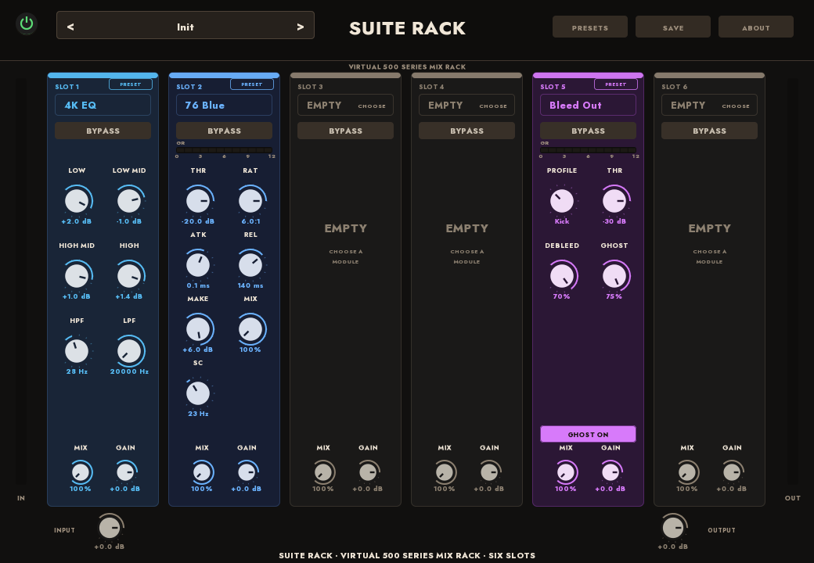
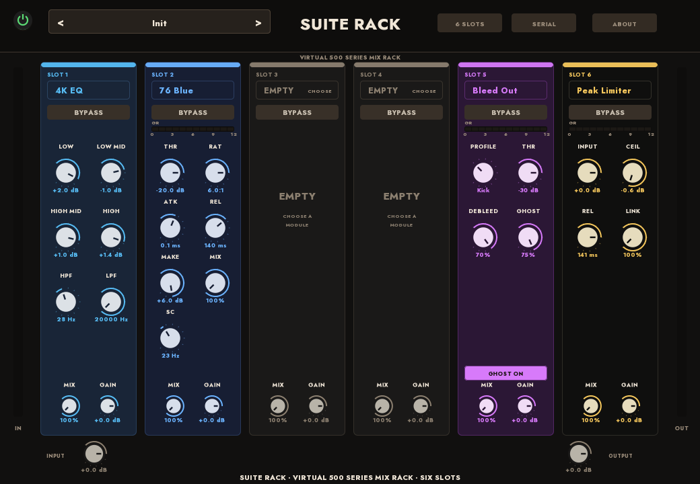
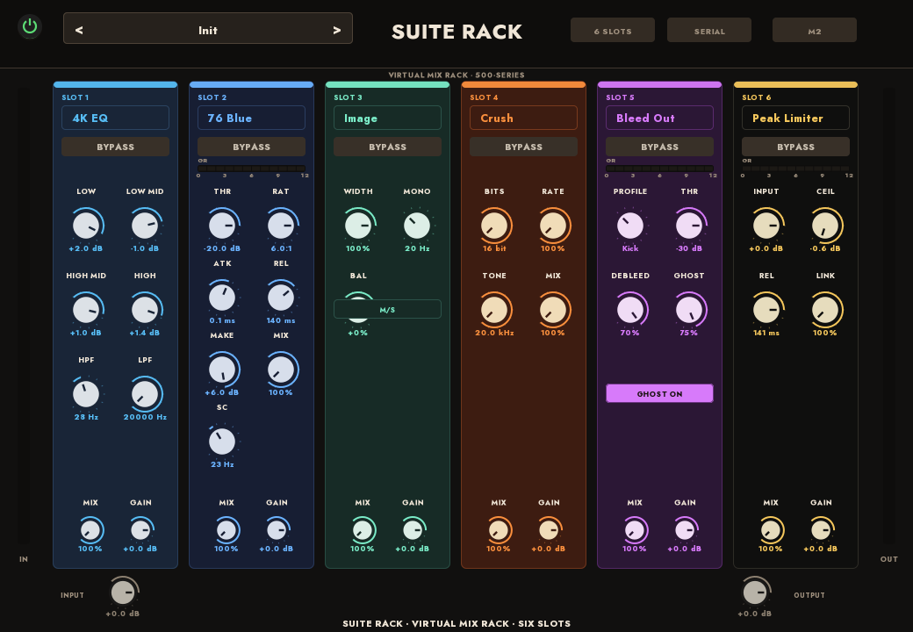

# Suite Rack

**Status: 0.9.0-m2 — CLAP + LV2, module registry and twenty-three modules.**
The rest of the catalog, drag/reorder, module presets, browser search and user
presets are next.

A virtual 500-series rack in the Suite visual language: six serial slots, each
hosting one compact module. Slot 1 starts as EQ, slot 2 as Comp, slots 3–6 are
empty. Modules are chosen from an in-panel browser.

Suite Rack is the flagship “try all my stuff” plugin: one insert that gives the
flavour of the whole Suite, plus new mix-world extras. Each module is limited to
a real 500-series control set — one job, a handful of knobs, no deep pages. The
standalone plugins remain the full versions.

> Better plugins exist. I just wanted to have a Suite Rack.








## What goes in the rack

**From the Suite:**

- **Comp Suite** — Clean, Easy, 76Blue, 76Black, 2A, 3A, Xpress, VCA, Molot, Red
- **Patina** — Valve, Console, Bus, Tape, Transformer
- **Space Suite** — Plate, Room, Hall, Spring, Digital/Tape/Analog/Ping-Pong
  Delay, Chorus, Flanger, Phaser, Dimension
- **Vocal Suite** — De-Ess, Air
- **Drum Suite** — Transient, Clip, Bleed Out gate
- **Trowel** — Smoothing, Tame
- **Suite Channel** — 4K EQ, Gate/Ducker
- **Hearth** — Hearth EQ, Hearth Comp
- **Adhesive** — Glue, Reel
- **Brick / Mastering Suite** — Peak Limiter, Tilt, Density
- **Ember** — Ember finish
- **Repair Suite** — Cleanup (De-Click + De-Hum only)
- **JClones** — 16 neutral-named ports, including L2, Classic Limiter, Hyrax,
  O3, Modern Limiter, RS-124, VBL, CL-1B, LMC-1, Bloom, Fattener, AC-1,
  Tape Head, DuTape, Tube Driver and DaTube

**New extras:**

- **Image** — stereo width, mono-maker, balance, M/S
- **Dynamic EQ** — frequency-selective dynamics
- **Multiband** — 3-band compressor
- **Sub** — subharmonic synthesizer
- **Double** — doubler / microshift
- **Filter** — auto-filter / envelope filter
- **Crush** — bitcrusher / lo-fi
- **Motion** — tremolo / auto-pan / rotary
- **Rider** — auto-level / vocal rider

**Not in the rack:** Common Sense EQ, Amp Suite, Bass Suite, and the deep Repair
Suite tools (spectral editor, De-Clip, De-Reverb, De-Noise). Those do not fit
the 500-series format; Cleanup is the lightweight repair representative.

## Current 0.9.0-m2 slice

- 1040×720 panel with the Comp Suite-family header: power, preset bar, centered
  title, utility pills.
- Six vertical 500-series-style module columns, each with its own background and
  knob colour.
- Per-slot bypass, mix and gain.
- Double-click a knob to reset it to the active module's default.
- Stepped controls, used by the Bleed Out profile selector.
- Bleed Out has a separate automated **GHOST ON** button.
- Filled slots hide the **CHOOSE** hint so longer module names have room.
- Module browser with **ALL / EQ / COMP / COLOUR / DYN** categories and scrolling.
- Generic per-slot controls: twelve control slots plus type, bypass, mix and
  gain. Host automation follows the slot, not the module.
- **Available modules:** 4K EQ, Hearth EQ, Tilt, Air, 76 Blue, 76 Black, 2A,
  3A, VCA, Valve, Console, Bus, Tape, Transformer, Gate, Transient, Clip and
  De-Ess, Density, Bleed Out, Peak Limiter, Image and Crush.
- Serial engine and per-slot meters in place; DSP and panel tests pass.
- **CLAP and LV2 builds** load in REAPER with the six-column editor and process
  audio.
- **Shared state format** for CLAP and LV2; project save/reload recalls the
  rack settings in both formats.
- **State and automation mapping tests** cover round-trip recall, dirty-flag
  reporting and slot/global parameter mapping.
- The rest of the catalog, browser search, drag/reorder and module presets are
  next.

## Architecture

```
Input → Slot 1 → Slot 2 → Slot 3 → Slot 4 → Slot 5 → Slot 6 → Output
```

Each slot owns a module instance and a 16-control parameter block. Module type
and module state are stored separately, so the host parameter count stays small
even with the full catalog. All module controls are normalised 0–1; the module
registry maps them to faceplate labels, display formats and DSP behaviour.
Automation follows the slot, not the module: if a slot changes module, its
control lanes are repurposed.

The module DSP itself lives in **hearth-dsp 0.4.0** under
`third_party/hearth-dsp`, pulled in as a git submodule. Suite Rack keeps only
the rack engine and the adapter that maps its slot controls onto the shared
typed module controls, so future plugins can use the same EQ, compressor,
colour, gate, transient, clip and de-esser stages.

## Build and preview

```sh
git submodule update --init --recursive
cmake -S . -B build -DCMAKE_BUILD_TYPE=Release
cmake --build build -j
ctest --test-dir build --output-on-failure
./build/rack_ui_preview assets/fonts /tmp/suite-rack-preview
```

## Install

CLAP:

```sh
cp build/clap/SuiteRack.clap ~/.clap/
cp -r build/clap/SuiteRack.resources ~/.clap/
```

LV2:

```sh
cp -r build/lv2/suite-rack.lv2 ~/.lv2/
```

## Next

1. Browser search and module descriptions.
2. Drag/reorder and module presets.
3. Suite core modules: Hearth Comp, Glue, Space, Bleed Out, Trowel
   Smoothing/Tame, Peak Limiter, Ember, Reel, Cleanup, Density.
4. New extras: Image, Dynamic EQ, Multiband, Sub, Double, Filter, Crush, Motion,
   Rider.
5. JClones ports, 510 and Pultec.
6. User preset saving across the Suite.

GPL-3.0-or-later.
